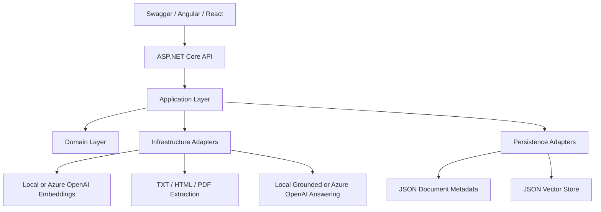
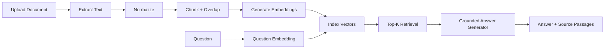
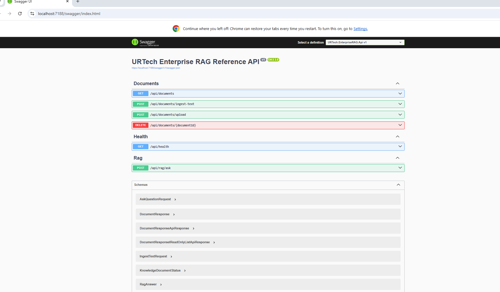
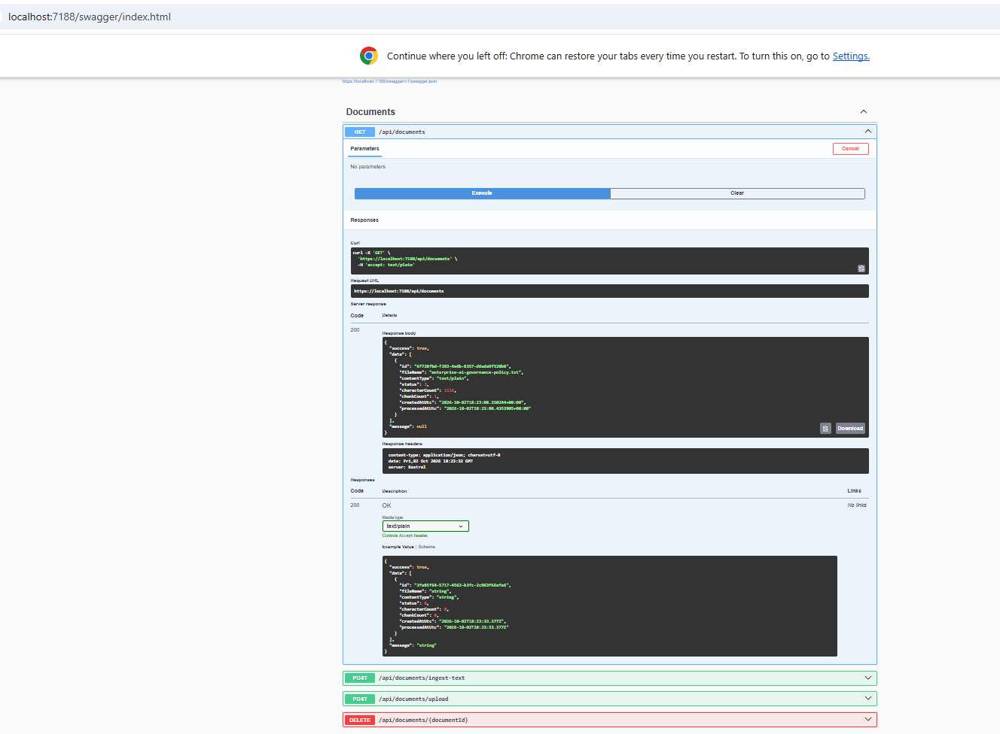

# URTech Enterprise RAG Reference API

A public, security-safe **.NET 8 layered / Clean Architecture reference application** demonstrating an end-to-end Retrieval-Augmented Generation (RAG) workflow for enterprise document knowledge.

> This repository is intentionally a focused portfolio/reference implementation. It demonstrates architecture, C#/.NET engineering and AI/RAG patterns without publishing the complete private enterprise application or private development history.

## Verified local status

The backend working copy was validated locally in Visual Studio 2022 before packaging for GitHub:

- **7/7 .NET projects built successfully**
- **0 build warnings**
- **0 build errors**
- Swagger/OpenAPI started successfully
- `GET /api/documents` returned HTTP 200
- `POST /api/documents/upload` successfully indexed a text-based PDF
- `POST /api/rag/ask` returned HTTP 200 with a grounded answer, source passages and similarity scores
- Angular client ran successfully at `http://localhost:4200`
- React/Vite client ran successfully at `http://localhost:5173`
- Seeded enterprise AI-governance knowledge was indexed and returned


### Verified end-to-end evidence

The repository includes runtime screenshots from the locally verified application:

| Evidence | Screenshot |
|---|---|
| Angular RAG client | [View](docs/images/05-angular-rag-client.png) |
| React RAG client | [View](docs/images/06-react-rag-client.png) |
| Swagger endpoint overview | [View](docs/images/08-swagger-endpoints-overview.png) |
| PDF upload/indexing | [View](docs/images/10-pdf-upload-success.png) |
| Indexed documents after upload | [View](docs/images/11-indexed-documents-after-upload.png) |
| Grounded RAG answer + sources | [View](docs/images/09-rag-api-grounded-answer.png) |

See [Verified Local Results](docs/testing/VERIFIED_LOCAL_RESULTS.md) for the complete walkthrough.


## What this application demonstrates

- C# / .NET 8 / ASP.NET Core Web API
- Layered / Clean Architecture
- Domain, Application, Infrastructure, Persistence, Shared, API and Tests
- Document ingestion (`.txt`, `.md`, `.csv`, `.json`, `.html`, text-based `.pdf`)
- Text normalization
- Sliding-window chunking with overlap
- Embedding abstraction
- Local deterministic embeddings for zero-secret local execution
- Optional Azure OpenAI embeddings
- Vector similarity search using cosine similarity
- Top-K retrieval
- RAG orchestration
- Grounded answers with source passages
- Local extractive answer generation for zero-secret local execution
- Optional Azure OpenAI grounded answer generation
- File-backed document metadata and vector persistence
- xUnit tests
- Swagger / OpenAPI
- Azure DevOps CI pipeline example
- Secret-safe configuration pattern
- Angular and React reference clients

## Architecture



## End-to-end RAG flow



## Visual Studio project structure


## Layer responsibilities

| Project | Responsibility |
|---|---|
| `URTech.EnterpriseRAG.Domain` | Core knowledge-document entity and lifecycle status |
| `URTech.EnterpriseRAG.Application` | Use cases, contracts, chunking, ingestion, retrieval and RAG orchestration |
| `URTech.EnterpriseRAG.Infrastructure` | File extraction, embedding providers, answer providers and technical adapters |
| `URTech.EnterpriseRAG.Persistence` | Reference document/vector persistence implementations |
| `URTech.EnterpriseRAG.Shared` | Cross-cutting response contract |
| `URTech.EnterpriseRAG.Api` | HTTP endpoints, dependency composition, Swagger and demo seeding |
| `URTech.EnterpriseRAG.UnitTests` | Automated tests for chunking, local embeddings and RAG flow |
| `ui/angular` | Optional Angular reference client |
| `ui/react` | Optional React/Vite reference client |

## API surface



| Method | Endpoint | Purpose |
|---|---|---|
| GET | `/api/health` | Runtime/provider health information |
| GET | `/api/documents` | List indexed knowledge documents |
| POST | `/api/documents/ingest-text` | Ingest raw text directly |
| POST | `/api/documents/upload` | Upload and index a supported document |
| DELETE | `/api/documents/{documentId}` | Remove document metadata and vectors |
| POST | `/api/rag/ask` | Ask a grounded question over indexed knowledge |

### Verified document response



## Run locally

### Prerequisites

- Visual Studio 2022 with the .NET 8 SDK, or the .NET 8 SDK directly
- Node.js and npm when running the Angular or React clients

### Visual Studio

1. Open `URTech.EnterpriseRAG.Reference.sln`.
2. Set `URTech.EnterpriseRAG.Api` as the startup project.
3. **Build → Rebuild Solution**.
4. **Test → Run All Tests**.
5. Start the API using the `https` profile.
6. Swagger opens at `https://localhost:7188/swagger` when the default launch profile is unchanged.

The application starts in **Local** mode and automatically indexes a small enterprise AI-governance policy so the RAG endpoint can be exercised immediately.

Try:

```json
POST /api/rag/ask
{
  "question": "Who approves privileged access requests?",
  "topK": 4,
  "minimumSimilarityScore": 0.02
}
```

## Upload your own document

Use `POST /api/documents/upload` in Swagger. Example files are provided under `sample-documents/`.

Supported reference formats:

- `.txt`
- `.md`
- `.csv`
- `.json`
- `.html` / `.htm`
- text-based `.pdf`

Scanned/image-only PDFs require OCR; Azure AI Document Intelligence is documented as the natural production extension point.

### Where uploaded knowledge is stored locally

The public reference persists runtime metadata and searchable vector records under the API project:

```text
src/URTech.EnterpriseRAG.Api/App_Data/
    documents.json
    vectors.json
```

The current reference does not retain the original uploaded binary after extraction. `App_Data` is excluded from source control. See [Local Persistence and Uploaded Documents](docs/testing/PERSISTENCE_AND_UPLOADS.md).

## Local mode versus Azure OpenAI mode

The repository defaults to local deterministic implementations so reviewers can run the complete retrieval flow without cloud credentials.

### Local mode — default

- `LocalHashEmbeddingGenerator`
- `LocalGroundedAnswerGenerator`
- JSON-backed metadata/vector persistence

### Optional Azure OpenAI mode

Set:

```json
"Rag": {
  "EmbeddingProvider": "AzureOpenAI",
  "AnswerProvider": "AzureOpenAI"
}
```

Supply actual values through **.NET User Secrets**, environment variables, Key Vault or another approved secret-management mechanism:

- `AzureOpenAI:Endpoint`
- `AzureOpenAI:ApiKey`
- `AzureOpenAI:EmbeddingDeployment`
- `AzureOpenAI:ChatDeployment`

No real credentials are committed to this repository.

## Angular and React clients

The repository includes two working UI clients over the same .NET 8 backend:

- `ui/angular` — Angular RAG client (`http://localhost:4200`)
- `ui/react` — React/Vite RAG client (`http://localhost:5173`)

Both clients use development proxies for `/api`, keeping RAG orchestration and retrieval centralized in the backend.

### Angular verified result


### React verified result


For start-to-finish UI instructions, see [Angular and React Client Testing](docs/frontend/FRONTEND_TESTING.md).

## Testing documentation

- [Testing scenarios](docs/testing/TESTING_SCENARIOS.md)
- [Verified local results and screenshots](docs/testing/VERIFIED_LOCAL_RESULTS.md)
- [API testing guide](docs/testing/API_TESTING.md)
- [Angular and React testing](docs/frontend/FRONTEND_TESTING.md)
- [Local persistence and uploaded documents](docs/testing/PERSISTENCE_AND_UPLOADS.md)
- [Quick start](QUICK_START.md)
- [Code walkthrough](docs/CODE_WALKTHROUGH.md)
- [Architecture details](docs/architecture/ARCHITECTURE.md)

## Production extension points

The layered design allows the reference adapters to be replaced without changing the Application use cases:

- JSON vector store → Azure AI Search / PostgreSQL pgvector / another approved vector database
- JSON metadata → SQL Server / Azure SQL with EF Core
- Local embeddings → Azure OpenAI embeddings
- Local extractive answering → Azure OpenAI chat model
- Text-based PDF extraction → Azure AI Document Intelligence for OCR/scanned documents
- Anonymous local API → Microsoft Entra ID / OAuth 2.0 and role-based authorization
- Local logging → Application Insights / OpenTelemetry
- Secrets → Azure Key Vault / managed identity
- Direct API exposure → Azure API Management

## Security and ownership

- No API keys or passwords are committed.
- Cloud configuration is opt-in.
- Runtime `App_Data` is excluded from source control.
- The public package contains no `.git` history, `.vs`, `bin`, `obj`, or local runtime data.
- See [SECURITY.md](SECURITY.md) and [NOTICE.md](NOTICE.md).

## Repository purpose

This repository is a public portfolio/reference implementation intended to demonstrate enterprise .NET, layered architecture and RAG engineering patterns. The complete enterprise Workflow360 application, internal project documentation and broader business implementation remain private.
