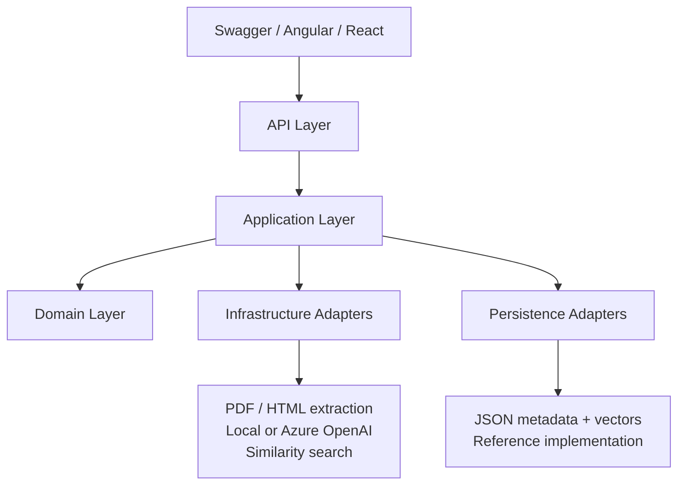
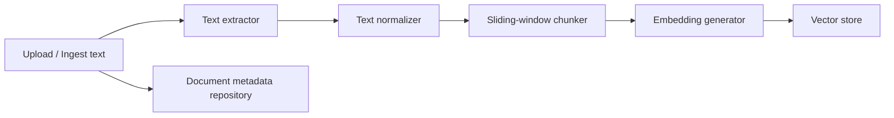
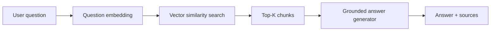
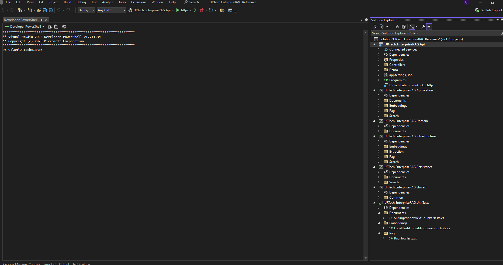

# Architecture — URTech Enterprise RAG Reference API

This reference application demonstrates how a Retrieval-Augmented Generation (RAG) solution can be implemented inside a layered .NET architecture instead of placing AI logic directly in controllers.

## Layered architecture

### Dependency rule

The important design rule is that the **Application layer owns the use-case contracts**. Infrastructure and Persistence implement those contracts. The Application layer therefore does not need to know whether embeddings come from the local deterministic provider or Azure OpenAI, and it does not need to know whether vectors are stored in JSON, memory, Azure AI Search, or another approved vector database.

## RAG ingestion flow

## RAG query flow

## Project structure captured from the verified local solution

## Layer responsibilities

| Layer | Responsibility | Examples |
|---|---|---|
| Domain | Business meaning and lifecycle state | `KnowledgeDocument`, `KnowledgeDocumentStatus` |
| Application | Use cases, interfaces, orchestration, DTOs | `DocumentIngestionService`, `RagService`, `IEmbeddingGenerator`, `IVectorStore` |
| Infrastructure | Technical adapters | PDF/HTML extraction, local/Azure OpenAI providers, in-memory vector adapter |
| Persistence | Local reference persistence | JSON document repository, JSON vector store |
| Shared | Cross-cutting contracts | `ApiResponse<T>` |
| API | HTTP boundary and dependency composition | Controllers, Swagger, startup, demo seeding |
| Tests | Automated regression protection | Chunking, deterministic embeddings, end-to-end RAG flow |
| UI | Optional client examples | Angular and React reference clients |

## Production extension path

The reference adapters are intentionally replaceable. A production enterprise version can move to:

- Azure OpenAI embeddings and chat completion
- Azure AI Search or another approved vector database
- SQL Server / Azure SQL metadata persistence
- Azure AI Document Intelligence for OCR/scanned documents
- Microsoft Entra ID authentication and role-based authorization
- Azure Key Vault and managed identity for secrets
- Application Insights / OpenTelemetry for tracing and operational metrics
- API Management for policy, throttling, versioning and governance
