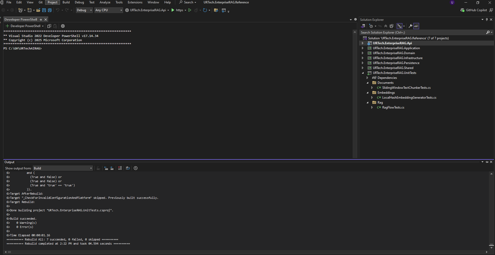
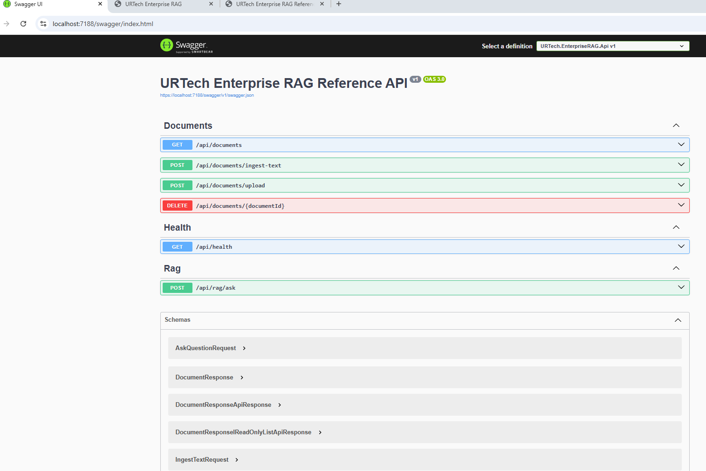
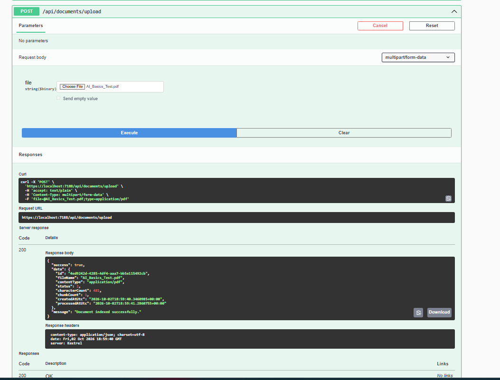
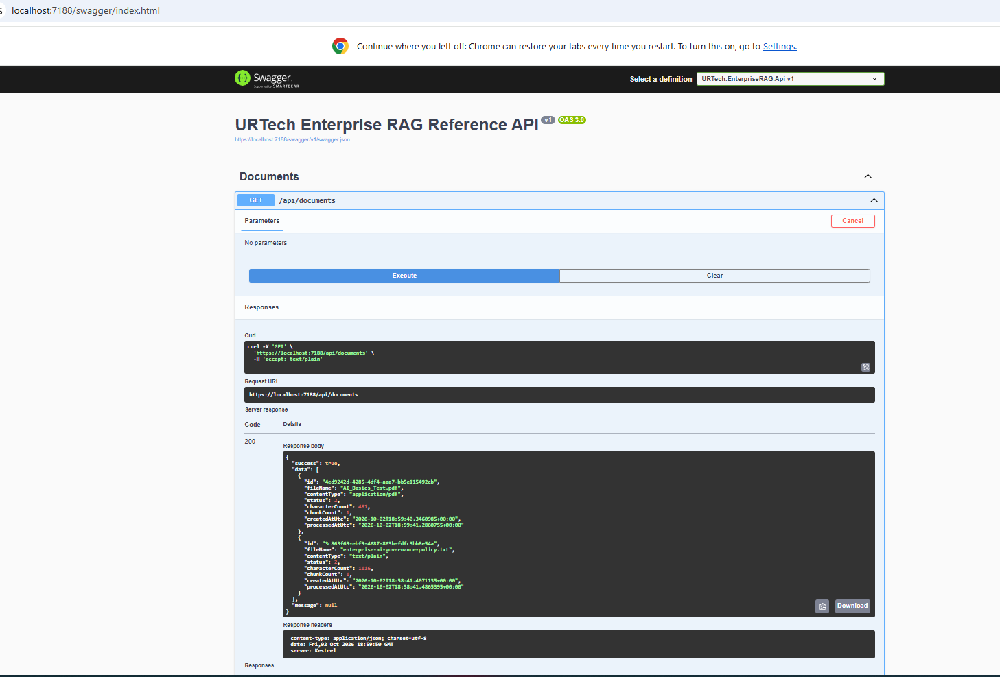
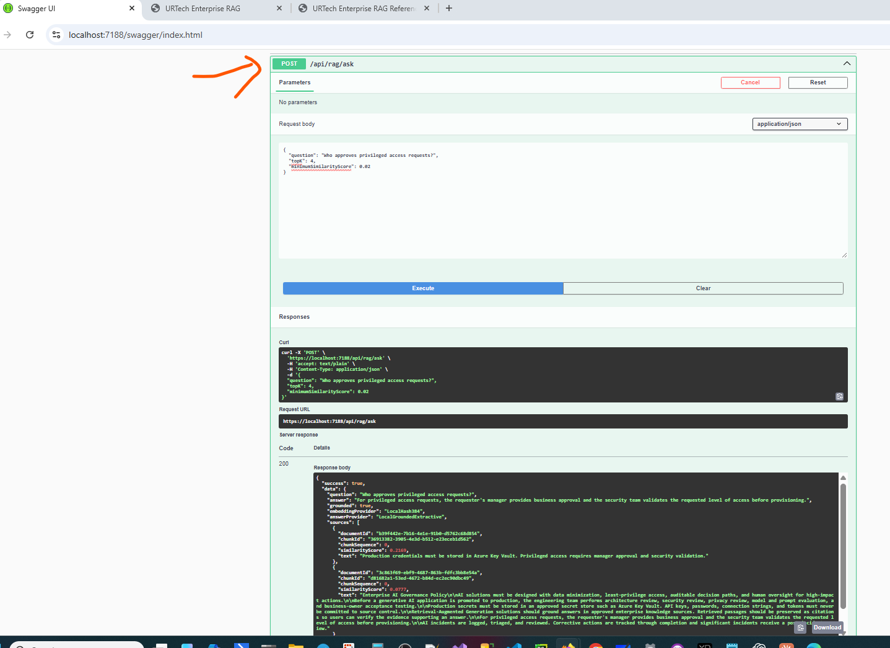
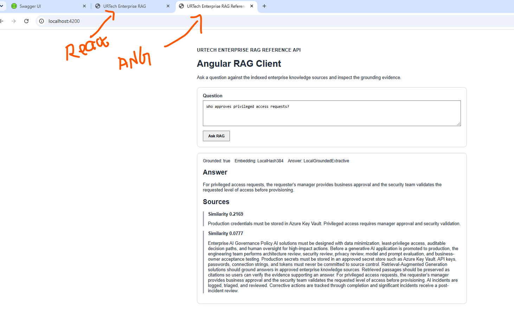
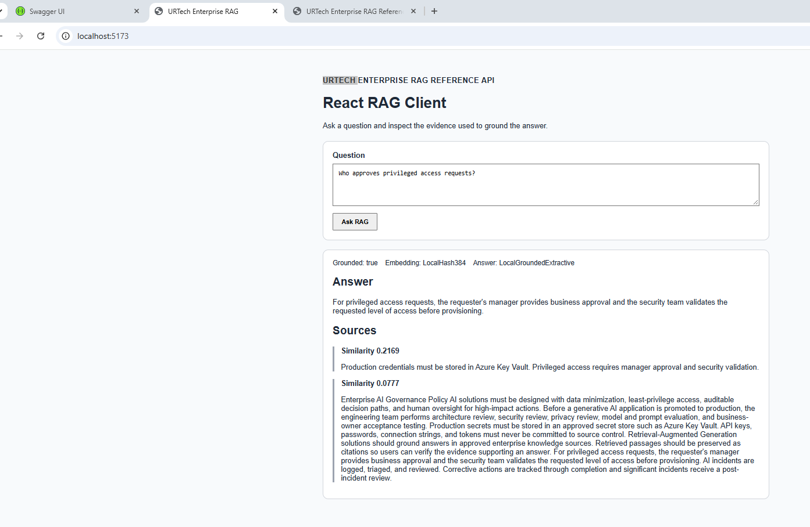

# Verified Local Results

This document records the local execution evidence captured from the working copy of **URTech Enterprise RAG Reference API** on October 2, 2026.

The screenshots in `docs/images/` are runtime evidence from the same public reference implementation. They are included so a reviewer can see the application running, not only read the source code.

## Verification summary

| Area | Verification | Result |
|---|---|---|
| .NET solution build | Visual Studio 2022 rebuild | **7/7 projects succeeded, 0 failed, 0 warnings, 0 errors** |
| Swagger / OpenAPI | API started on local HTTPS profile | **Working** |
| Document listing | `GET /api/documents` | **HTTP 200** |
| PDF upload | `POST /api/documents/upload` with `AI_Basics_Test.pdf` | **HTTP 200; indexed successfully** |
| Indexed document retrieval | `GET /api/documents` after upload | **Uploaded PDF returned** |
| RAG query | `POST /api/rag/ask` | **HTTP 200; grounded answer + sources returned** |
| Angular client | `http://localhost:4200` | **Working against the same .NET API** |
| React client | `http://localhost:5173` | **Working against the same .NET API** |

> Automated xUnit tests are included in the repository and can be run from Visual Studio Test Explorer or `dotnet test`. The screenshots below focus on the locally verified build and end-to-end runtime scenarios.

## 1. Build success



The build output shows seven projects successfully rebuilt with no failures, warnings or errors.

## 2. Swagger API surface



The API exposes document ingestion and management, health, and RAG question-answering endpoints.

## 3. PDF upload and indexing



A text-based PDF (`AI_Basics_Test.pdf`) was uploaded through `POST /api/documents/upload`. The API returned HTTP 200 and reported that the document was indexed successfully.

## 4. Uploaded document returned from the repository



`GET /api/documents` returned the uploaded PDF together with the seeded enterprise AI-governance policy.

## 5. RAG request and grounded response



The request:

```json
{
  "question": "Who approves privileged access requests?",
  "topK": 4,
  "minimumSimilarityScore": 0.02
}
```

returned HTTP 200 with:

- `grounded: true`
- an answer based on retrieved policy content
- embedding provider information
- answer-provider information
- source passages
- similarity scores

This demonstrates the end-to-end path:

```text
Question
  -> question embedding
  -> vector similarity search
  -> Top-K source retrieval
  -> grounded answer generation
  -> answer + evidence
```

## 6. Angular client



The Angular client runs on `http://localhost:4200` and calls the same .NET RAG API through its local development proxy. The captured result shows a grounded answer and supporting source passages.

## 7. React client



The React/Vite client runs on `http://localhost:5173` and calls the same .NET RAG API through the Vite development proxy. The captured result shows the same RAG answer and evidence path.

## Runtime topology used for verification

```text
Angular :4200 ----\
                   \
                    >---- ASP.NET Core API :7188 ---- Application ---- RAG ---- persistence
                   /
React :5173 ------/

Swagger ----------> ASP.NET Core API :7188
```

The UI clients do not contain a second RAG implementation. They are deliberately thin clients over the same backend API so retrieval, grounding, security controls and provider selection remain centralized in the .NET service.
